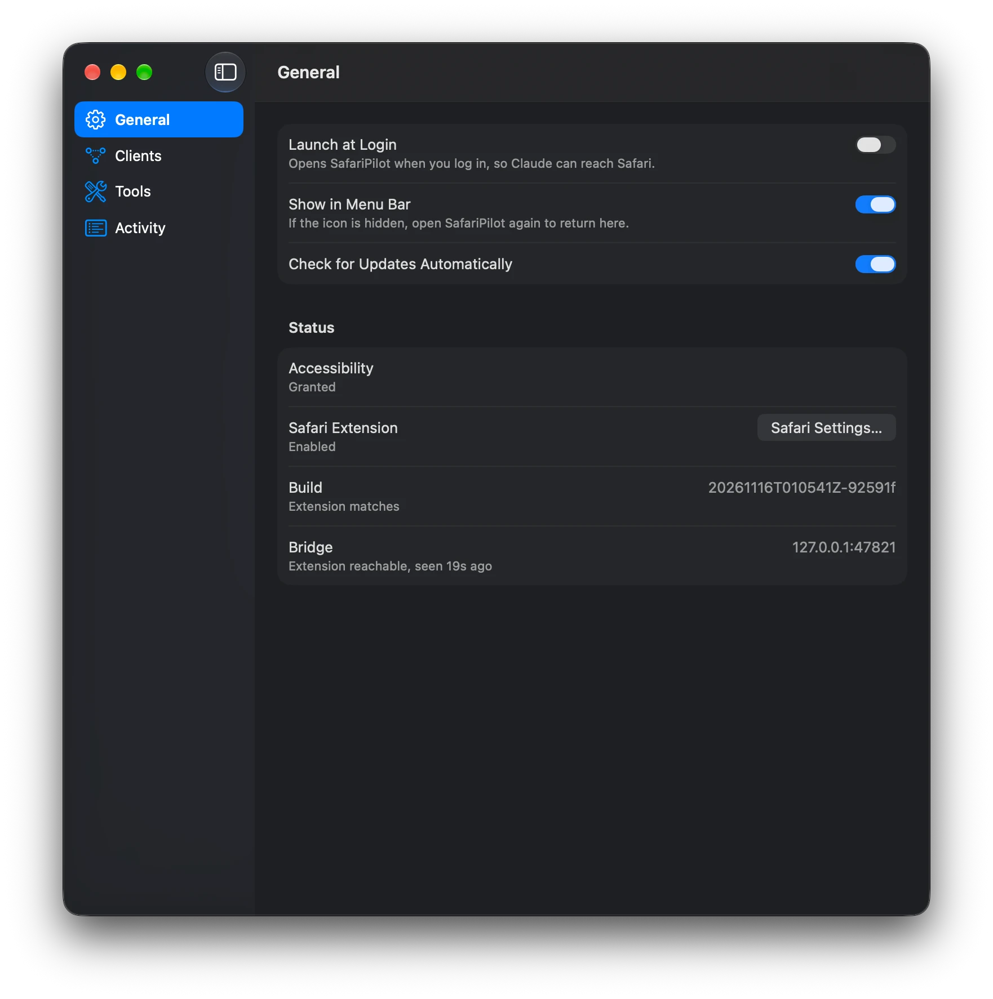

<p align="center"></p>

<p align="center"><a href="https://scorecard.dev/viewer/?uri=github.com/johnsusek/SafariPilotMCP"></a> <a href="https://github.com/johnsusek/SafariPilotMCP/actions/workflows/ci.yml"></a> <a href="https://github.com/johnsusek/SafariPilotMCP/actions/workflows/codeql.yml"></a></p>

# SafariPilot
SafariPilot is a local MCP server for Safari on macOS. Agents work in the Safari
you're already signed in to, and you keep using your Mac.

## Features

- **Your signed-in Safari.** Your agent works in the Safari you already use, with your logins and cookies.
- **No cursor takeover.** Your cursor doesn't move, keystrokes go only to Safari, and Safari can stay behind the app you're working in. [Synthetic vs Trusted Input](#synthetic-vs-trusted-input) explains the trade-off.
- **Real clicks.** Plain clicks and text input go through macOS Accessibility, so pages get trusted input. Key presses and double-clicks have caveats (see below).
- **Fewer round trips.** Each action returns what it changed on the page, so the agent doesn't have to read the page again.

<p align="center"> </p>

## Requirements

- macOS 26 or later
- Safari 27 (earlier versions are untested)
- A user logged in to the Mac's desktop. The app and Safari need a GUI session.
  
> [!NOTE]
> **Local only:** SafariPilot controls Safari on the same Mac as the MCP client. It can't drive a remote or cloud browser.

## Install

```bash
brew install --cask johnsusek/tap/safaripilot
```

Or download the DMG from [Releases](https://github.com/johnsusek/SafariPilotMCP/releases/latest) and drag SafariPilot to Applications. Releases are built, signed and notarized in GitHub Actions; to check that a DMG came from this repo's workflow:

```bash
gh attestation verify SafariPilot-*.dmg --repo johnsusek/SafariPilotMCP
```

Open SafariPilot. It lives in the menu bar; choose **Settings…** there to see its window. Then:

1. In Safari, open **Settings > Extensions** and turn on **SafariPilot**.
2. In SafariPilot's **General** pane, grant **Accessibility**.
3. In the **Clients** pane, set up your client: Claude Desktop, Claude Code, ChatGPT and Codex, Cursor, VS Code or LM Studio. For any other client, use **Other Clients**.
4. Ask your agent to open a page in Safari and click a link. Approve the client when SafariPilot asks.

### Updates

SafariPilot checks for updates and offers to install them. **Check for Updates…** in its menu checks now, and the **General** pane turns automatic checks off. Homebrew installs can also update with:

```bash
brew upgrade --cask safaripilot
```

### Build from source

Needs Xcode, Node.js and [XcodeGen](https://github.com/yonaskolb/XcodeGen).

```bash
scripts/install.sh
```

This builds SafariPilot, installs it in `/Applications`, opens it and links the `safaripilot` CLI into `/opt/homebrew/bin`.

## Tools

The tools mirror those of [Claude in Chrome](https://claude.com/chrome).

- **Tabs:** `tabs_list`, `tab_create`, `tab_select`, `tab_close`, `navigate`
- **Read:** `read_page`, `find`, `get_page_text`, `screenshot`, `wait`
- **Act:** `click`, `form_input`, `key`, `drag`, `scroll`, `scroll_to`, `file_upload`, `handle_dialog`, `resize_window`
- **Inspect:** `javascript`, `read_console_messages`, `read_network_requests`, `page_fetch`
- **Batch:** `browser_batch` runs several calls in one round trip.

The **Tools** pane in the app shows each tool's full description.

> [!WARNING]
> **Agent permissions:** An agent acts as you on every site you're signed in to. It can read pages, submit forms and upload files there, as well as run JavaScript and read network requests. Review which clients you approve, and take care with sensitive accounts.

## Security and trust

- **Approve every client.** Each new client needs your approval. A client you always trust gets a credential in its MCP settings, so other software on your Mac can't pass itself off as that client.
- **Tab isolation.** Each agent session gets its own Safari window and sees only the tabs it opened, plus any popups from those; SafariPilot closes them all when the session ends.
- **Secure local connection.** The Safari extension, the app and the agent talk only over loopback, and every connection needs a secret token that changes each launch.
- **Secrets stay hidden.** Page reads, URLs and network logs redact password fields, card numbers, tokens and cookies.

> [!CAUTION]
> Redaction isn't data-loss prevention. Screenshots, `javascript` results, `page_fetch` and other tool responses can still contain sensitive information.

## Synthetic vs Trusted Input

Pages can tell real user input ("trusted") from events created in JavaScript ("synthetic"), and some sites reject synthetic events. Nearly all of SafariPilot's input is trusted. The exceptions:

- **Always synthetic:** color inputs, `drag`, and double, triple, right and modifier clicks. SafariPilot can't send these as trusted input without taking your cursor or making Safari the active app.
- **Synthetic by default:** `key` presses (not `form_input` text entry) and `form_input` on dates, times, selects and sliders. `compat: true` makes them trusted but brings the pilot window in front of your other Safari windows, because Safari sends real key presses and native menus only to its frontmost window. Safari as a whole can still stay behind other apps.

## Limits

- No hover: the CSS `:hover` pseudo-class is never applied.
- `key` refuses Cmd shortcuts so an agent can't trigger app or system commands with them.

## Troubleshooting

In SafariPilot's window, **General > Status** shows Accessibility, the Safari extension and its connection, and **Activity** lists each call with the error code of any that failed.

| Error code | Fix |
| --- | --- |
| `approval_required` | Approve the client in SafariPilot's dialog. |
| `accessibility_denied` | Grant **Accessibility** in SafariPilot's **General** pane. |
| `site_access_prompt`, `site_access_denied` | Allow the site from the SafariPilot button in Safari's toolbar. |
| `no_content_script` | Turn on the extension in **Safari Settings > Extensions**, then open a new tab. |
| `safari_unavailable` | Open Safari. |
| `build_mismatch` | Safari is running the extension from another copy of SafariPilot. Remove the other copy, or run `scripts/install.sh` when building from source. |
| `app_unavailable` | Open SafariPilot from `/Applications`. |

## Benchmark

SafariPilot against Claude in Chrome, both driven by Claude Code (Sonnet) with the same prompts. Each ran 11 tasks 5 times, and all 110 runs passed. SafariPilot took 601 s in total to Chrome's 1,304 s, and used 36% fewer input tokens. [scripts/compare](scripts/compare) runs it.

<picture><source media="(prefers-color-scheme: dark)" srcset="docs/benchmark/tools-dark.webp"></picture>

<picture><source media="(prefers-color-scheme: dark)" srcset="docs/benchmark/tasks-dark.webp"></picture>

## Why SafariPilot

- **Instead of [safari-mcp](https://github.com/achiya-automation/safari-mcp):** real clicks and keys without bringing Safari forward, approval per client, and secrets hidden from the agent.
- **Instead of [MCPSafari](https://github.com/Epistates/MCPSafari):** real clicks and keys without bringing Safari forward, approval per client, and network request bodies.
- **Instead of [Apple's Safari MCP](https://webkit.org/blog/18136/introducing-the-safari-mcp-server-for-web-developers/):** it works in your signed-in Safari, where Apple's opens a separate window without your logins.

## How it runs

The MCP client starts `safaripilot mcp`, a stdio MCP server inside the app. That server passes each tool call to the SafariPilot menu bar app, which controls Safari through the SafariPilot extension and macOS Accessibility APIs. The server opens the app if it isn't running.

## More

- [Architecture](docs/ARCHITECTURE.md): how it works inside, building and testing.
- [Security policy](SECURITY.md): reporting a vulnerability.
- [License](LICENSE): MIT.

## Thanks

To [iMCP](https://github.com/mattt/iMCP), whose app UI and client approval flow inspired SafariPilot's.
