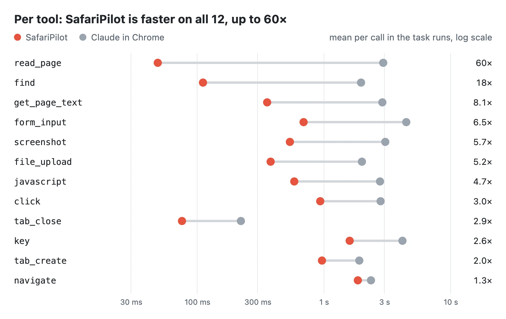

<p align="center"></p>

<p align="center"><a href="https://scorecard.dev/viewer/?uri=github.com/johnsusek/SafariPilotMCP"></a> <a href="https://github.com/johnsusek/SafariPilotMCP/actions/workflows/ci.yml"></a> <a href="https://github.com/johnsusek/SafariPilotMCP/actions/workflows/codeql.yml"></a></p>

# SafariPilot
SafariPilot is a local MCP server for Safari on macOS. It lets agents work in
your existing Safari session while you continue using your Mac.

## Features

- **Your signed-in Safari.** Your agent works in the Safari you already use, with your logins and cookies.
- **No cursor takeover.** Your cursor doesn't move, keystrokes go only to Safari, and Safari can stay behind the app you're working in. [Windows and focus](#windows-and-focus) lists what changes while you work in Safari itself.
- **Real clicks and typing.** Plain clicks go through macOS Accessibility and keys are real key presses, so pages get trusted input. Forms and editors that ignore scripted events still work.
- **Fewer page reads.** Each action returns what it changed on the page, so the agent doesn't read the page again.

<p align="center"> </p>

## Requirements

- macOS 26 or later
- Safari 27 (earlier versions are untested)
- A user logged in to the Mac's desktop. The app and Safari need a GUI session.
  
> [!NOTE]
> **Local macOS software required:** SafariPilot controls Safari on the same Mac as the MCP client. It is not a standalone remote or cloud browser.

## Install

```bash
brew install --cask johnsusek/tap/safaripilot
```

Or download the DMG from [Releases](https://github.com/johnsusek/SafariPilotMCP/releases/latest) and drag SafariPilot to Applications. Releases are built, signed and notarized in GitHub Actions; to check that a DMG came from this repo's workflow:

```bash
gh attestation verify SafariPilot-*.dmg --repo johnsusek/SafariPilotMCP
```

Open SafariPilot. It lives in the menu bar; choose **Settings…** there to see its window. Then:

1. In Safari, open **Settings > Extensions** and turn on **SafariPilot**.
2. In SafariPilot's **General** pane, grant **Accessibility**.
3. In the **Clients** pane, set up your client: Claude Desktop, Claude Code, ChatGPT and Codex, Cursor, VS Code or LM Studio. For any other client, use **Other Clients**.
4. Ask your agent to open a page in Safari and click a link. Approve the client when SafariPilot asks.

### Updates

SafariPilot checks for updates itself and offers to install them. **Check for Updates…** in its menu checks now, and the **General** pane turns automatic checks off. Homebrew installs can also update with:

```bash
brew upgrade --cask safaripilot
```

### Build from source

Needs Xcode, Node.js and [XcodeGen](https://github.com/yonaskolb/XcodeGen).

```bash
scripts/install.sh
```

This builds SafariPilot, installs it in `/Applications`, opens it and links the `safaripilot` CLI into `/opt/homebrew/bin`.

## Tools

The tools mirror those of [Claude in Chrome](https://claude.com/chrome).

- **Tabs:** `tabs_list`, `tab_create`, `tab_select`, `tab_close`, `navigate`
- **Read:** `read_page`, `find`, `get_page_text`, `screenshot`, `wait`
- **Act:** `click`, `form_input`, `key`, `drag`, `scroll`, `scroll_to`, `file_upload`, `handle_dialog`, `resize_window`
- **Inspect:** `javascript`, `read_console_messages`, `read_network_requests`, `page_fetch`
- **Batch:** `browser_batch` runs several calls in one round trip.

The **Tools** pane in the app shows each tool's full description.

> [!WARNING]
> **Agent permissions:** These tools can read page content, interact with authenticated websites, submit forms, upload files, execute JavaScript, inspect network requests, and navigate tabs. Review client approvals and use care with sensitive accounts.

## Security and trust

- **Approve every client.** Each new client needs approval first. Uses a token to bypass approvals, so other software on your system can't impersonate your AI agent.
- **Tab isolation.** An agent sees only the tabs it opened and the popups they open.
- **Secure local connection.** The Safari extension, the app and the agent talk only over loopback, and every connection needs a secret token that changes each launch.
- **Secrets stay hidden.** Passwords, card numbers, tokens and cookies stay hidden from agents' page reads, URLs and network logs. Screenshots and `javascript` results are not filtered.

> [!CAUTION]
> Normal page reads, URLs, and network logs redact or omit supported password fields, card numbers, tokens, and cookies. This is not a complete data-loss-prevention guarantee: screenshots, JavaScript results, page fetches, and other tool responses may contain sensitive information.

## Windows and focus

Agents share one Safari window of their own, the pilot window. `tab_create` opens it when none is open, and it closes with its last tab. It can sit behind other windows, but it can't be minimized and Safari can't be hidden.

While you work in another app, nothing here takes focus from it, apart from the last two notes below. While you work in another Safari window, some tools do:

| Tool or event | Effect on the Safari window you are in |
| --- | --- |
| `tab_create` with no pilot window open | Safari shows the new window in front. SafariPilot focuses your window again at once, so the pilot window flashes. |
| `tab_create` with the pilot window open | None. The tab opens in the background of the pilot window. |
| `key`, and `form_input` on date, time and slider inputs | Takes keyboard focus. These are real key presses, which Safari sends to its main window, so the pilot window is made the main window. |
| `form_input` on a `select` | Safari's menu for the select opens on screen until the option is picked. |
| A page that opens its own tab or window | Safari opens it as it would for you, which can bring the pilot window in front. |
| `click`, `screenshot`, `tab_select` and other `form_input` | None. They switch the pilot window to the agent's tab where it sits. |
| `resize_window` | None. The pilot window changes size where it sits. |
| Reads, `navigate`, `scroll`, `scroll_to`, `javascript`, `file_upload`, `page_fetch`, `handle_dialog`, `drag` | None. |

- If you click into another Safari window while `key` is typing, it stops and reports how many keys it sent.
- A covered pilot window is hidden as far as its page can tell, so Safari slows the page's timers and pauses its animation frames. Pages that draw on animation frames can show stale values.
- Rarely, Safari itself comes forward after focus moves into a field on a page. **Activity** logs it as "Safari came forward".
- SafariPilot's approval dialog floats above every app until you answer it.

## Limits

- No hover: the CSS `:hover` pseudo-class is never applied. 
- Double, triple, right and modifier clicks and `drag` are synthetic events, which some pages ignore.
- `key` refuses Cmd shortcuts, to prevent system interaction.

## Troubleshooting

In SafariPilot's window, **General > Status** shows Accessibility, the Safari extension and its connection, and **Activity** lists each call with the error code of any that failed.

| Error code | Fix |
| --- | --- |
| `approval_required` | Approve the client in SafariPilot's dialog. |
| `accessibility_denied` | Grant **Accessibility** in SafariPilot's **General** pane. |
| `site_access_prompt`, `site_access_denied` | Allow the site from the SafariPilot button in Safari's toolbar. |
| `no_content_script` | Turn on the extension in **Safari Settings > Extensions**, then open a new tab. |
| `safari_unavailable` | Open Safari. |
| `build_mismatch` | Safari is running the extension from another copy of SafariPilot. Remove the other copy, or run `scripts/install.sh` when building from source. |
| `app_unavailable` | Open SafariPilot from `/Applications`. |

## Benchmark

SafariPilot against Claude in Chrome, both driven by Claude Code (Sonnet) with the same prompts. Over 11 tasks run 5 times each, all 110 runs passed, and SafariPilot took 601 s in total against 1,304 s with 36% fewer input tokens. [scripts/compare](scripts/compare) runs it.

<picture><source media="(prefers-color-scheme: dark)" srcset="docs/benchmark/tools-dark.webp"></picture>

<picture><source media="(prefers-color-scheme: dark)" srcset="docs/benchmark/tasks-dark.webp"></picture>

## Why SafariPilot

- **Instead of [safari-mcp](https://github.com/achiya-automation/safari-mcp):** real clicks and keys without bringing Safari forward, approval per client, and secrets hidden from the agent.
- **Instead of [MCPSafari](https://github.com/Epistates/MCPSafari):** real clicks and keys without bringing Safari forward, approval per client, and network request bodies.
- **Instead of [Apple's Safari MCP](https://webkit.org/blog/18136/introducing-the-safari-mcp-server-for-web-developers/):** it works in your signed-in Safari, where Apple's opens a separate window without your logins.

## How it runs

The MCP client starts `safaripilot mcp`, a stdio MCP server inside the app. That server passes each tool call to the SafariPilot menu bar app, which controls Safari through the SafariPilot extension and macOS Accessibility APIs. The server opens the app if it isn't running.

## More

- [Architecture](docs/ARCHITECTURE.md): how it works inside, building and testing.
- [Security policy](SECURITY.md): reporting a vulnerability.
- [License](LICENSE): MIT.

## Thanks

To [iMCP](https://github.com/mattt/iMCP), whose app UI and client approval flow inspired SafariPilot's.
