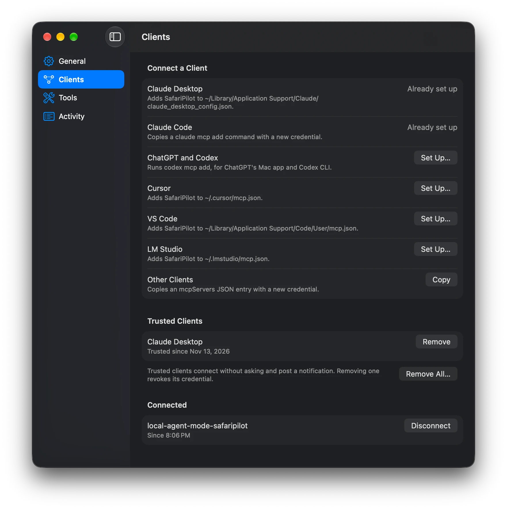
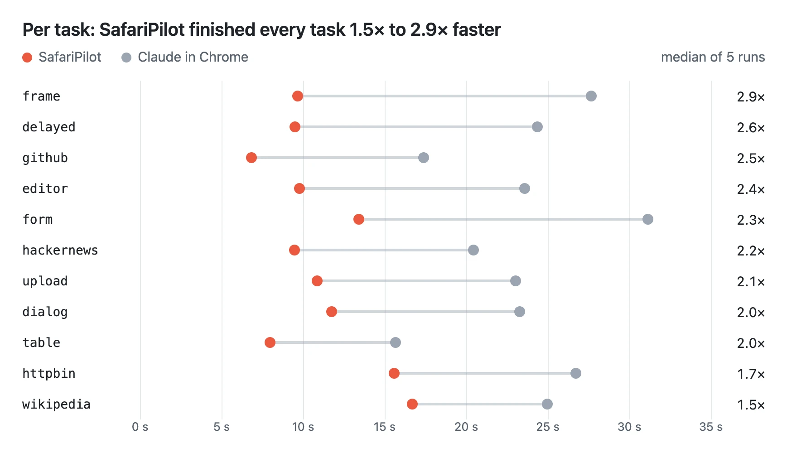
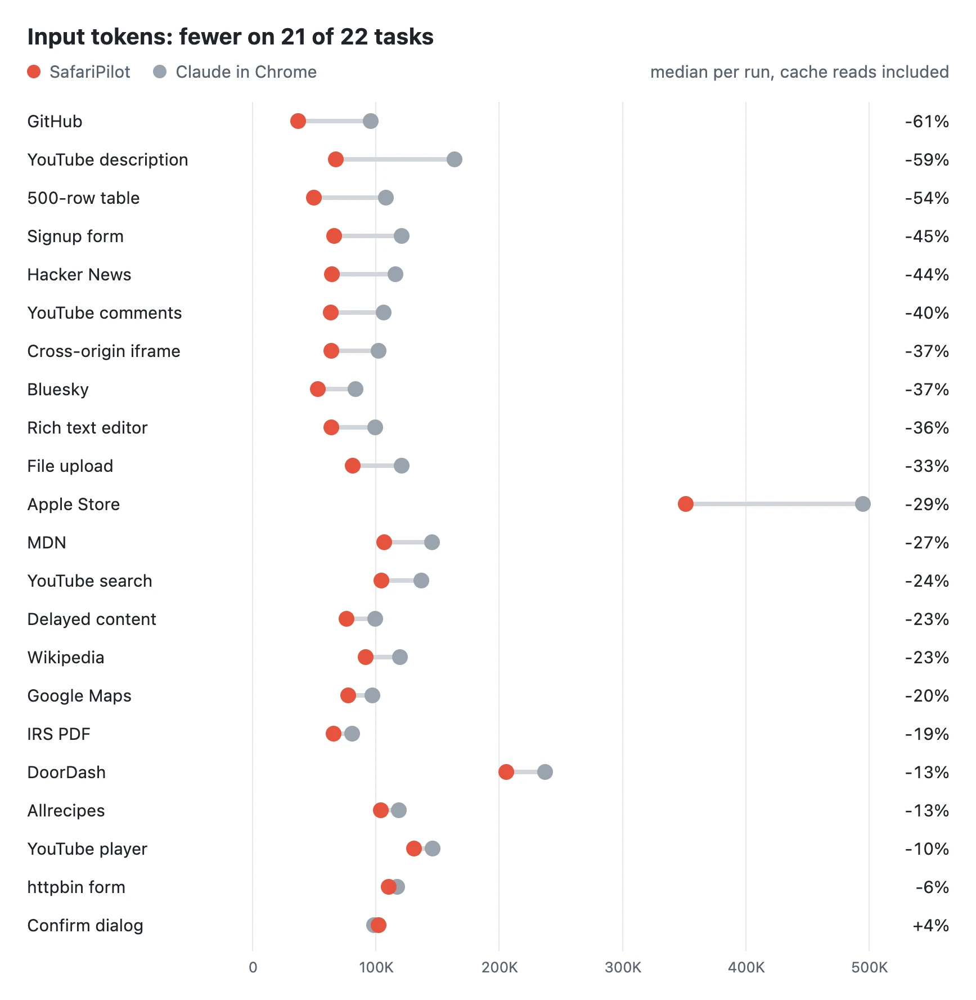

<p align="center"></p>

<p align="center"><a href="https://github.com/johnsusek/SafariPilotMCP/actions/workflows/ci.yml"></a> <a href="https://github.com/johnsusek/SafariPilotMCP/actions/workflows/codeql.yml"></a></p>

# SafariPilot
SafariPilot is a local MCP server for Safari on macOS. Your agent works in the Safari you're already signed in to, in a separate window, and you keep using your Mac: it never brings Safari to the front, never switches your tabs, and never takes your cursor or keyboard.

## Features

- **Your signed-in Safari.** Your agent works in the Safari you already use, with your logins and cookies.
- **No cursor takeover.** Your cursor doesn't move, keystrokes go only to Safari, and Safari can stay behind the app you're working in.
- **Real clicks.** Plain clicks and text input go through macOS Accessibility, so pages get trusted input. Key presses and double-clicks have caveats (see below).
- **Optimized.** 2.1x faster than Claude in Chrome on 32% fewer tokens.

<p align="center"> </p>

## Requirements

- macOS 26 or later
- Safari 27 (earlier versions are untested)
- A user logged in to the Mac's desktop. The app and Safari need a GUI session.
  
> [!NOTE]
> **Local only:** SafariPilot controls Safari on the same Mac as the MCP client. It can't drive a remote or cloud browser.

## Install

```bash
brew install --cask johnsusek/tap/safaripilot
```

Or download the DMG from [Releases](https://github.com/johnsusek/SafariPilotMCP/releases/latest) and drag SafariPilot to Applications. 

## Configure

Open SafariPilot. It has a menu bar icon; choose **Settings…** there if you don't see its window. Then:

1. In Safari, open **Settings > Extensions** and turn on **SafariPilot**.
2. In SafariPilot's **General** pane, grant **Accessibility**.
3. In the **Clients** pane, set up your client: For supported apps configuration is a single click. Use Other Clients if your app isn't listed.
4. Ask your agent to open a page in Safari and click a link. Approve the client when SafariPilot asks.

### Updates

SafariPilot automatically updates itself from the attested GitHub releases. Homebrew installs can also update with:

```bash
brew upgrade --cask safaripilot
```

### Build from source

Needs Xcode, Node.js and [XcodeGen](https://github.com/yonaskolb/XcodeGen).

```bash
scripts/install.sh
```

This builds SafariPilot, installs it in `/Applications`, opens it and links the `safaripilot` CLI into `/opt/homebrew/bin`.

## Security and Trust

> [!WARNING]
> **Agent permissions:** An agent acts as you on every site you're signed in to. It can read pages, submit forms and upload files there, as well as run JavaScript and read network requests. Review which clients you approve, and take care with sensitive accounts.

- **Approve every client.** Each new client needs your approval. A client you always trust gets a credential in its MCP settings, so other software on your Mac can't pass itself off as that client.
- **Tab isolation.** Each agent session gets its own Safari window and sees only the tabs it opened, plus any popups from those; SafariPilot closes them all when the session ends.
- **Secure local connection.** The Safari extension, the app and the agent talk only over loopback, and every connection needs a secret token that changes each launch.
- **Attested builds.** Releases are built, signed and notarized in GitHub Actions, which attests each DMG. This means you can verify the app you are running was built from the source code you can see on GitHub. Use `gh attestation verify SafariPilot-*.dmg --repo johnsusek/SafariPilotMCP` on a downloaded release, to verify the commit and workflow run that built it.
- **Secrets stay hidden.** Page reads, URLs and network logs redact password fields, card numbers, tokens and cookies.

> [!CAUTION]
> Redaction isn't data-loss prevention. Screenshots, `javascript` results, `page_fetch` and other tool responses can still contain sensitive information.

## Troubleshooting

In SafariPilot's window, **General > Status** shows Accessibility, the Safari extension and its connection, and **Activity** lists each call with the error code of any that failed.

| Error code | Fix |
| --- | --- |
| `approval_required` | Approve the client in SafariPilot's dialog. |
| `accessibility_denied` | Grant **Accessibility** in SafariPilot's **General** pane. |
| `site_access_prompt`, `site_access_denied` | Allow the site from the SafariPilot button in Safari's toolbar. |
| `no_content_script` | Turn on the extension in **Safari Settings > Extensions**, then open a new tab. |
| `safari_unavailable` | Open Safari. |
| `build_mismatch` | Safari is running the extension from another copy of SafariPilot. Remove the other copy, or run `scripts/install.sh` when building from source. |
| `app_unavailable` | Open SafariPilot from `/Applications`. |

## Benchmark

Claude Code (Sonnet 5.5) drove both browsers with the same prompts and no other tools. Of the 22 tasks, 15 run on public sites such as YouTube, DoorDash, the Apple Store and a PDF on irs.gov; the other 7 use local test pages. Each task ran 3 to 5 times per browser, and all 176 runs passed.

SafariPilot finished in under half the time, 1,176 s against Chrome's 2,471 s, with 32% fewer input tokens and 46% fewer output tokens. [scripts/compare](scripts/compare) runs the tasks and draws the charts.

<picture><source media="(prefers-color-scheme: dark)" srcset="docs/benchmark/tasks-dark.webp"></picture>

<picture><source media="(prefers-color-scheme: dark)" srcset="docs/benchmark/tokens-dark.webp"></picture>

Tool times are the mean of every call in those runs. Claude in Chrome does its clicks, typing, scrolling and screenshots through one computer tool, so each of those calls counts under the SafariPilot tool that does the same job.

<picture><source media="(prefers-color-scheme: dark)" srcset="docs/benchmark/tools-dark.webp"></picture>

## Comparison

| | SafariPilot | safari-mcp | MCPSafari |
| --- | --- | --- | --- |
| Makes Safari the active app | Never | Sometimes, then switches back to your app | Needs you to, for real input |
| Puts its window in front of your Safari windows | Only with `compat: true` | No, it works in your window | When selecting a tab and for real input |
| Changes the tab you're looking at | Never | For real input and screenshots | For new tabs and screenshots |
| Takes your cursor or keyboard | Never | During file upload | During real input |

### Competitors

- **[safari-mcp](https://github.com/achiya-automation/safari-mcp)** has no trusted input in its everyday click, type and key tools; pages that check for it need its separate native tools. Since its tabs open in your window, real input and screenshots switch the tab you're looking at, and its AppleScript can bring Safari to the front. Passwords and tokens on the page reach the agent unredacted.
- **[MCPSafari](https://github.com/Epistates/MCPSafari)** can't send a trusted click. Its real input needs Safari in front, and its hover and drag move your pointer. Its network log has no request bodies, and like safari-mcp, it never asks you to approve a client.
- **[Apple's Safari MCP](https://webkit.org/blog/18136/introducing-the-safari-mcp-server-for-web-developers/)** can't use your signed-in Safari; it opens a separate window without your logins.

## Synthetic vs Trusted Input

Pages can tell real user input ("trusted") from events created in JavaScript ("synthetic"), and some sites reject synthetic events. Nearly all of SafariPilot's input is trusted. The exceptions:

- **Always synthetic:** color inputs, `drag`, and double, triple, right and modifier clicks. SafariPilot can't send these as trusted input without taking your cursor or making Safari the active app.
- **Synthetic by default:** `key` presses (not `form_input` text entry) and `form_input` on dates, times, selects and sliders. `compat: true` makes them trusted but brings the pilot window in front of your other Safari windows, because Safari sends real key presses and native menus only to its frontmost window. Safari as a whole can still stay behind other apps.

## How it runs

The MCP client starts `safaripilot mcp`, a stdio MCP server inside the app. That server passes each tool call to the SafariPilot menu bar app, which controls Safari through the SafariPilot extension and macOS Accessibility APIs. The server opens the app if it isn't running.

## Tools

The tools mirror those of [Claude in Chrome](https://claude.com/chrome).

- **Tabs:** `tabs_list`, `tab_create`, `tab_select`, `tab_close`, `navigate`
- **Read:** `read_page`, `find`, `get_page_text`, `screenshot`, `wait`
- **Act:** `click`, `form_input`, `key`, `drag`, `scroll`, `scroll_to`, `file_upload`, `handle_dialog`, `resize_window`
- **Inspect:** `javascript`, `read_console_messages`, `read_network_requests`, `page_fetch`
- **Batch:** `browser_batch` runs several calls in one round trip.

## More

- [Architecture](docs/ARCHITECTURE.md): how it works inside, building and testing.
- [Security policy](SECURITY.md): reporting a vulnerability.
- [License](LICENSE): MIT.

## Thanks

To [iMCP](https://github.com/mattt/iMCP), whose app UI and client approval flow inspired SafariPilot's.
